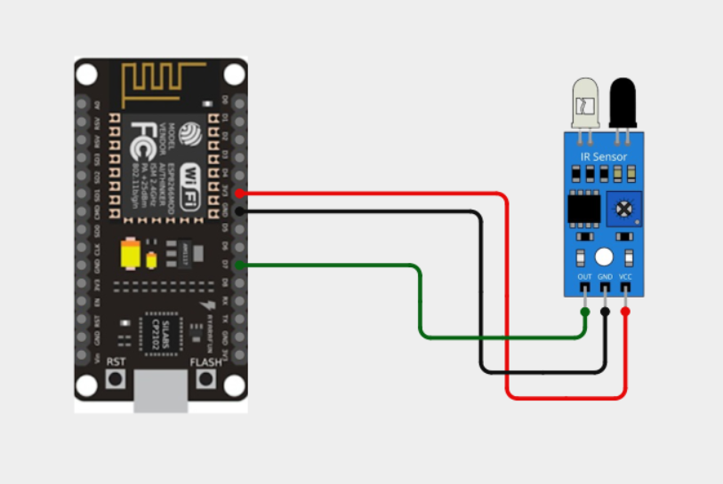
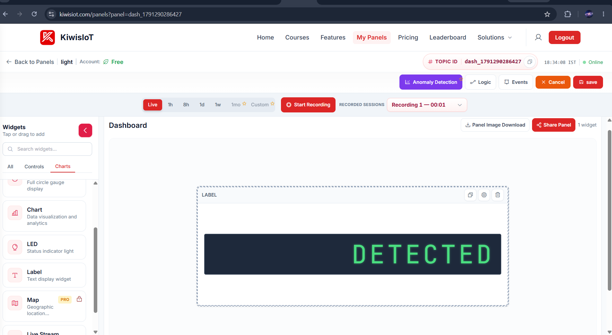
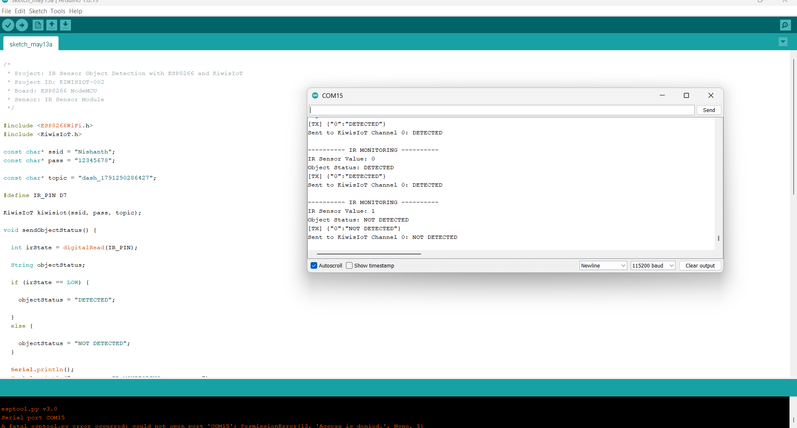

# ESP8266-Powered Smart Detection System Using KiwisIoT

Detects the presence of an object using an IR obstacle sensor connected to an ESP8266 (NodeMCU) and streams the status (`DETECTED` / `NOT DETECTED`) to a live KiwisIoT dashboard every 2 seconds.

**Project ID:** KIWISIOT-002
**Board:** ESP8266 NodeMCU (ESP-12E)
**Sensor:** IR Sensor Module (3-pin obstacle sensor with adjustable sensitivity)
**Platform:** KiwisIoT (Panels / Widgets)

---

## Features

- Reads an IR obstacle sensor on digital pin `D7` (GPIO13)
- Converts the raw reading into a human-readable object status
- Prints live monitoring data to the Serial Monitor at 115200 baud
- Sends the status to KiwisIoT channel `0` every 2 seconds
- Non-blocking timing using `millis()`, with `kiwisiot.run()` kept in the main loop

## Hardware Required

| Component | Qty | Notes |
|---|---|---|
| ESP8266 NodeMCU (ESP-12E) | 1 | Any NodeMCU/ESP8266 dev board |
| IR Sensor Module | 1 | 3-pin: OUT, GND, VCC |
| Micro USB cable | 1 | Must support data transfer |
| Jumper wires | 3 | Female-to-male recommended |

## Circuit Diagram



| IR Sensor Pin | NodeMCU Pin | Wire Colour (diagram) |
|---|---|---|
| VCC | 3V3 | Red |
| GND | GND | Black |
| OUT | D7 | Green |

```
NodeMCU                 IR Sensor
-------                 ---------
3V3  ------ Red ------- VCC
GND  ------ Black ----- GND
D7   ------ Green ----- OUT
```

> **Tip:** Adjust the small blue potentiometer on the IR sensor to set the detection distance. The onboard LED on the sensor lights up when an object is detected.

## Logic

The IR sensor output is **active LOW**:

| `digitalRead(D7)` | Meaning | Status sent |
|---|---|---|
| `LOW` (0) | Object in front of sensor | `DETECTED` |
| `HIGH` (1) | Nothing in front of sensor | `NOT DETECTED` |

## Software Setup

1. Install the **Arduino IDE** (1.8.x or 2.x).
2. Add the ESP8266 board package:
   `File → Preferences → Additional Boards Manager URLs`
   ```
   http://arduino.esp8266.com/stable/package_esp8266com_index.json
   ```
   Then `Tools → Board → Boards Manager` and install **esp8266**.
3. Install the **KiwisIoT** library from the Library Manager (or the KiwisIoT documentation).
4. Select the board: `Tools → Board → NodeMCU 1.0 (ESP-12E Module)`.
5. Select the port: `Tools → Port → COMxx` (Windows) or `/dev/ttyUSBx` (Linux/macOS).
6. Open `src/IR_Object_Detection.ino`, and replace the placeholders:
   ```cpp
   const char* ssid  = "YOUR_WIFI_NAME";
   const char* pass  = "YOUR_WIFI_PASSWORD";
   const char* topic = "YOUR_DASHBOARD_TOPIC_ID";
   ```
7. Click **Upload**, then open the Serial Monitor at **115200 baud**.

> **Security:** Never commit real Wi-Fi credentials or dashboard topic IDs. Keep them in a local `secrets.h` file and add that file to `.gitignore`.

## Dashboard Output

1. Log in to KiwisIoT and open **My Panels → Create Panel**.
2. Copy the **Topic ID** (format: `dash_XXXXXXXXXX`) and paste it into the `topic` variable.
3. Drag a **Label** (or **LED**) widget onto the dashboard.
4. Bind the widget to **Channel 0**.
5. Click **Start Recording** to log the status history, and **Save** the panel.

The widget displays `DETECTED` or `NOT DETECTED` in real time.



## Coding Insert



Full sketch (`src/IR_Object_Detection.ino`):

```cpp
#include <ESP8266WiFi.h>
#include <KiwisIoT.h>

const char* ssid  = "YOUR_WIFI_NAME";
const char* pass  = "YOUR_WIFI_PASSWORD";
const char* topic = "YOUR_DASHBOARD_TOPIC_ID";

#define IR_PIN D7

KiwisIoT kiwisiot(ssid, pass, topic);

void sendObjectStatus() {
  int irState = digitalRead(IR_PIN);

  String objectStatus;
  if (irState == LOW) {
    objectStatus = "DETECTED";
  } else {
    objectStatus = "NOT DETECTED";
  }

  Serial.println();
  Serial.println("---------- IR MONITORING ----------");
  Serial.print("IR Sensor Value: ");
  Serial.println(irState);
  Serial.print("Object Status: ");
  Serial.println(objectStatus);

  kiwisiot.send("0", objectStatus);

  Serial.print("Sent to KiwisIoT Channel 0: ");
  Serial.println(objectStatus);
}

void setup() {
  Serial.begin(115200);
  Serial.println();
  Serial.println(" IR OBJECT MONITORING ");

  pinMode(IR_PIN, INPUT);
  Serial.println("IR sensor initialized");

  Serial.println("Connecting to KiwisIoT...");
  kiwisiot.begin();
  Serial.println("KiwisIoT initialized");
  Serial.println("Starting object monitoring...");
}

void loop() {
  kiwisiot.run();

  static unsigned long lastSend = 0;
  if (millis() - lastSend >= 2000) {
    lastSend = millis();
    sendObjectStatus();
  }

  delay(100);
}
```

## Sample Serial Output

```
---------- IR MONITORING ----------
IR Sensor Value: 0
Object Status: DETECTED
[TX] {"0":"DETECTED"}
Sent to KiwisIoT Channel 0: DETECTED

---------- IR MONITORING ----------
IR Sensor Value: 1
Object Status: NOT DETECTED
[TX] {"0":"NOT DETECTED"}
Sent to KiwisIoT Channel 0: NOT DETECTED
```

## Project Structure

```
.
├── README.md
├── .gitignore
├── src/
│   └── IR_Object_Detection.ino
└── docs/
    ├── wiring_diagram.png
    ├── dashboard.png
    └── serial_monitor.png
```

Suggested `.gitignore`:

```
secrets.h
*.bin
build/
```

## Troubleshooting

| Problem | Likely cause | Fix |
|---|---|---|
| `Serial port COMxx: Access is denied` | Another program (Serial Monitor, another IDE window, or a previous upload) is holding the port | Close all Serial Monitors and other IDE windows, unplug/replug the board, then select the correct port again |
| `fatal: esptool.py error: invalid head of packet (0x00)` | Wrong board/port, bad USB cable, or the board is not entering flash mode | Use a data-capable USB cable, select *NodeMCU 1.0 (ESP-12E Module)*, hold **FLASH** while pressing **RST** (or retry upload), and lower the upload speed to 115200 |
| Status always says `NOT DETECTED` | Sensor not powered, or wired to the wrong pin | Check VCC → 3V3 and OUT → D7; confirm the sensor LED lights when an object is close |
| Status always says `DETECTED` | Sensor is too sensitive or sees a reflective surface | Turn the potentiometer counter-clockwise to reduce range |
| Dashboard shows no data | Wrong Topic ID, Wi-Fi not connected, or channel mismatch | Confirm the Topic ID, check the Serial Monitor for connection messages, and make sure the widget is on channel `0` |

## Future Improvements

- Count detections over time and show a detections-per-hour chart
- Add a buzzer or LED alert on detection
- Use the ESP8266 deep-sleep mode to reduce power use
- Add an OTA update option

## Licence

Released under the MIT Licence. See `LICENSE` for details.
